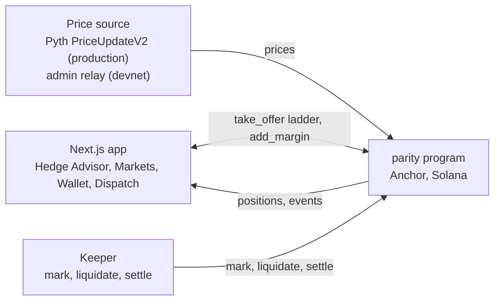

# Parity

Lock a future lira rate on Solana. The price comes from the interest-rate gap, not from a dealer.

> **Proposed design · Solana devnet · test tokens only · not offered to anyone, including Turkish residents, pending legal advice. The Hedge Advisor is a hedge calculator, not financial advice.**

Live app: [LINK] · Pitch video: [LINK] · Demo video: [LINK] · Colosseum project page: [LINK]

## The problem

The Turkish lira can lose a large share of its dollar value in days. Figures below are TCMB indicative USD rates (published daily at tcmb.gov.tr/kurlar), and anyone can reproduce them.

- 29 Dec 2017: 3.77 lira per dollar. 9 Oct 2026: 49.13.
- 31 Jul to 13 Aug 2018: the lira lost 28.8% of its dollar value in two weeks.
- 2021: the lira lost 42.8% over the year.
- 2023: 36.5%. 2024: 16.6%. 2025: 17.7%.

Annual CPI was 31.51% in August 2026 and the TCMB policy rate is 37% (see [docs/rates.md](docs/rates.md) and [docs/market-research.md](docs/market-research.md) for sources).

Three kinds of people carry this risk:

1. **Freelancers and remote workers paid in USD or USDC.** They earn dollars and owe lira for rent and bills, so next month's lira amount is a guess. This is our lead user. Turkey's services exports were $124.9 billion in 2025, and telecom, computer and information services exports were $6.72 billion, up 25.3% (TÜİK and Ministry of Trade data).
2. **Exporters and importers.** EUR/TRY, USD/TRY and USD/CNH exposure on 30 to 180 day invoices.
3. **Savers.** Gram gold (XAU/TRY per gram) is in the code as the GAU/TRY market. It is a proposed future product and the most legally sensitive one.

## How it works

Parity is a two-sided, margined, cash-settled forward market. One side goes long the base currency, the other short. There is no physical delivery.

**Forward price.** The program computes the forward from covered interest parity:

```
F = S × (1 + r_quote · t / B_quote) / (1 + r_base · t / B_base)
```

`S` is spot from the price source, `r` is an annual rate from an on-chain rate registry, `t` is time to maturity, and `B` is the day-count basis. In the program this is one integer expression in 1e8 fixed point.

Day count: 360 for USD, EUR, CHF, JPY, CNH, MXN, XAU and XAG; 365 for TRY, GBP, ZAR, INR and BRL (Brazil's 252-business-day convention is simplified to 365). For metals, the lease rate stands in for the base-currency rate. Seed rates are in [docs/rates.md](docs/rates.md); the gold and silver lease rates are marked there as unverified assumptions, and the app labels them.

With TRY at 37% and USD at 3.875%, the 90-day USD/TRY forward sits about 8% above spot. That gap is the carry the Advisor shows.

**Standing maker offers.** Makers post offers with a side, a spread, a tenor range and capacity. The program allows tenors of 1–365 days; the seeded offers quote 7–180 days. A taker picks an offer and a notional (minimum $10). The strike is the forward plus or minus the maker's spread. Offers are seeded by script in this build; there is no maker console.

**Margin.** Initial margin is at least 10% of notional on every market. In the seeded config, TRY pairs and GAU/TRY use 12% and all other markets use 10%. Both sides post margin in USDC (SPL Token) or USDG (Token-2022). The taker pays a 10 bps open fee.

**Mark to market.** Anyone can call `mark`. It reads the price, requires a newer publish time than the last mark, and updates each side's equity (margin plus PnL, with the forward discounted to today).

**Risk ladder.**

- Margin call when equity falls below 50% of initial margin.
- Liquidation when equity is below 20% of initial margin on 3 confirmed marks, at least 30 seconds apart.
- A liquidation closes 30% of the position first. If equity is still below 20% of the reduced margin, it closes the rest.
- A 1% penalty on closed notional goes to insurance, with 20% of it paid to the caller.

**Loss waterfall.** When a loss exceeds the loser's margin, it is covered in this order: loser margin, then the insurance fund (same mint), then a pro-rata haircut on the winner's payout. Every step emits an event. With 10% margin and a 20% liquidation threshold, the buffer is 2% of notional, so a gap like August 2018 goes straight to the waterfall. The app shows this instead of hiding it.

**Settlement.** After maturity, anyone can call `settle`. It pays out in cash in the position's mint (USDC or USDG) using the waterfall above. At maturity the forward equals spot, so the payout is `Q × (S_T − K)` converted to USD.

## Hedge Advisor

A client-side calculator. A guided check-in asks for persona, exposure, lira need, horizon (1, 3 or 6 months) and how a 10% move against you would feel, one question at a time.

- **Cost-aware hedge ratio.** A mean-variance rule, signed by direction. A hedger who sells the base forward (a USD earner) gets `h* = 1 + (F − E[S_T]) / (γ·σ²·X)`. A hedger who buys the base forward (an importer, a saver) gets `h* = 1 − (F − E[S_T]) / (γ·σ²·X)`. The result is clamped to [0, 1]. Opposite users get opposite advice, and the app shows the inputs.
- **Volatility.** EWMA (λ = 0.94) on daily returns, precomputed into `vol.json` at build time, with a floor of 10%.
- **Ladder.** Month 1 up to 100%, month 2 up to 75%, month 3 up to 50%, and so on, each scaled by `h*`. A rung under the $10 minimum position size is left out, and the Advisor says so.
- **Lock it.** One transaction with one `take_offer` per rung, so the whole ladder opens or none of it does.

Direct hedges only in this build. Cross-hedge ratios are on the roadmap.

## Markets

15 markets, all config-driven. Margin shown is the seeded initial margin.

| # | Market | Price composition | IM |
|---|---|---|---|
| 1 | USD/TRY | USD/TRY | 12% |
| 2 | EUR/TRY | EUR/USD × USD/TRY | 12% |
| 3 | GBP/TRY | GBP/USD × USD/TRY | 12% |
| 4 | GAU/TRY (gram gold) | XAU/USD × USD/TRY ÷ 31.1034768 | 12% |
| 5 | EUR/USD | EUR/USD | 10% |
| 6 | GBP/USD | GBP/USD | 10% |
| 7 | USD/CHF | USD/CHF | 10% |
| 8 | USD/JPY | USD/JPY | 10% |
| 9 | USD/CNH | USD/CNH | 10% |
| 10 | USD/MXN | USD/MXN | 10% |
| 11 | USD/BRL | USD/BRL | 10% |
| 12 | USD/ZAR | USD/ZAR | 10% |
| 13 | USD/INR | USD/INR | 10% |
| 14 | XAU/USD | XAU/USD | 10% |
| 15 | XAG/USD | XAG/USD | 10% |

The demo focuses on USD/TRY, EUR/TRY, GAU/TRY, EUR/USD and XAU/USD. GAU/TRY uses the XAU lease rate on its base side because the registry has 13 rate codes only.

## Architecture



Instructions: `initialize`, `set_params`, `set_rate`, `upsert_market`, `init_collateral`, `fund_insurance`, `create_offer`, `cancel_offer`, `take_offer`, `add_margin`, `mark`, `liquidate`, `settle`, plus demo-mode instructions (`set_demo_mode`, `set_demo_price`, `set_demo_clock`) and a read-only `debug_price`.

Repo layout: `programs/parity` (Anchor program), `app` (Next.js, TypeScript, Tailwind, wallet-adapter for Phantom, Solflare and Backpack), `advisor` (hedge math and volatility data), `scripts` (deploy, seed, relay, keeper), `shared` (market table and payout logic used by app and scripts).

## Prices on devnet

Pyth Hermes now needs an API key, and devnet has no fresh FX feeds. So on devnet the program runs in **demo mode** and prices come from an admin relay (`scripts/src/relay.ts`):

- With `PYTH_API_KEY` set, the relay forwards Pyth Hermes prices.
- Without a key, it uses ECB reference rates from Frankfurter. These update daily, so FX does not move intraday. CNY stands in for CNH.
- Gold and silver use static, labelled reference values (XAU 4000, XAG 48, overridable). They are not live prices, and the app says so.

In demo mode the admin can shock a price and move the clock to walk through a margin call and liquidation on video.

- A Dispatch shock on a single-feed market scales that feed everywhere it is used: shocking USD/TRY also moves EUR/TRY, GBP/TRY and GAU/TRY.
- In ECB mode the relay only rewrites a market when the daily reference changes, so a Dispatch shock stays until then. **In Hermes mode the relay rewrites prices about every tick, so it overwrites Dispatch shocks each tick**; use the relay's shock file for a lasting shock.
- "Reset demo state" sets the clock back to +0 and clears every demo price; the relay writes the reference prices again at its next tick (about 10 s).
- Devnet has no live Pyth FX feeds, so turning demo mode off pauses trading (the app refuses to lock without an on-chain price). The relay turns demo mode back on at its next tick.
- The Markets page shows "Prices last relayed" from the newest transaction on the DemoState account.

The production design reads Pyth `PriceUpdateV2` accounts on chain. That path is already implemented in `oracle.rs`: it checks that the account owner is the Pyth receiver, that the feed ID matches the market, that verification level is Full, that the price is no older than `max_price_age_secs`, and that confidence is within `max_conf_bps`. Weekend FX closure therefore halts marks, so nothing is liquidated on a stale price. User transactions never post price updates, which keeps a ladder inside the transaction size limit.

## Security notes

- **Oracle checks.** Feed ID, owner and verification level (`WrongFeed`), staleness (`MarketClosedOrStale`), confidence (`OracleConfidence`). `mark` requires a strictly newer publish time than the last one.
- **Payouts cannot be redirected or blocked.** Every transfer out of the vault goes to a token account of the position's mint that is owned by the party being paid (the long, the short or the offer's maker). Any such account is accepted, so a party cannot block a payout by reassigning their associated token account, and a permissionless caller cannot send funds to anyone else. Accounts with a memo-transfer requirement or CPI guard are rejected.
- **Token-2022 extension guard.** USDG is accepted only with MetadataPointer and TokenMetadata extensions. TransferFee, TransferHook and DefaultAccountState are rejected, and payout accounts are checked for extensions too.
- **Gated initialize.** `initialize` must be signed by the program's upgrade authority, so no one can front-run setup.
- **Position nonces** come from the offer's counter, never from caller input.
- **Rounding.** PnL is a zero-sum transfer: short = −long, with long PnL floored toward −∞. Fees round up.
- **Known limitations (deferred).** Rounding dust can strand the last micro-units of an offer's capacity; exhausted offers stay listed until the maker cancels them; admin margin-parameter changes apply to open offers.
- **Maturity.** `liquidate` is rejected after maturity; `settle` handles that case.

This code is unaudited.

## Business model

- 10 bps open fee from the taker.
- 10% of the maker's spread to the protocol.
- Liquidation penalties fill the insurance fund first. Only after that do they count as revenue.

## Competition

- **Borsa Istanbul VİOP.** USD/TRY futures and options trade in USD 1,000 contracts with fixed expiries, through a licensed Turkish intermediary. Parity offers positions from $10, tenors the program allows from 1 to 365 days (the seeded demo offers quote 7 to 180), and stablecoin margin and settlement. We have not compared fees, and we have not confirmed whether non-residents can open VİOP accounts, so we make no claim on either.
- **On-chain FX perpetuals** (Ostium on Arbitrum; GMTrade and Flash Trade on Solana). Perpetuals have no maturity and are kept near spot by a funding rate that changes over time, so the cost of a 90-day hedge is unknown on day one. A dated forward fixes the rate and the cost at the start, and its price comes from the published rate gap. We did not find a USD/TRY or TRY-cross listing on any of these venues.

## Devnet addresses

- Program ID: `55jabap7VG6LKKJtidxVRBuLaLzFz6P96uPUicR2e4EQ`
- Mints, offers, insurance accounts: see [docs/devnet.md](docs/devnet.md) (filled at deploy).

## Run locally

Requirements: Rust, the Solana CLI, Anchor, Node and pnpm.

```bash
pnpm install

# 1. local validator
solana-test-validator --reset

# 2. build, deploy, seed (mints, init, 13 rates, 15 markets, 40 offers, insurance)
CLUSTER=localnet scripts/deploy.sh

# 3. price relay and keeper, each in its own terminal
CLUSTER=localnet pnpm --filter scripts relay
CLUSTER=localnet pnpm --filter scripts keeper

# 4. app: copy app/.env.example to app/.env.local and fill it in: NEXT_PUBLIC_USDC_MINT and
#    NEXT_PUBLIC_USDG_MINT (from keys/mints.localnet.json), FAUCET_SECRET_KEY (keys/faucet.json)
pnpm --filter app dev
```

Every app variable is listed, names only, in [app/.env.example](app/.env.example). `NEXT_PUBLIC_*` values are inlined into the client bundle; `FAUCET_SECRET_KEY` and `PYTH_API_KEY` are server-only. Never set `PARITY_DEV_WALLET` on Vercel.

For devnet, use `CLUSTER=devnet` and fund the deployer with about 9 SOL first (program rent plus 3 SOL that `01-mints.ts` seeds into the faucet key; `FAUCET_SOL` overrides). The faucet key pays ATA rent on every faucet request (10,000 test USDC + 10,000 test USDG), so top it up when the faucet starts failing. Add `PYTH_API_KEY` to the relay's environment to use Pyth Hermes prices (and set `NEXT_PUBLIC_RELAY_SOURCE=hermes` so the app labels them).

Use a dedicated devnet RPC for the deployed app: `NEXT_PUBLIC_RPC_URL` ships to every browser, so it must be key-less or domain-restricted. The public endpoint rate-limits quickly. The app polls program accounts every 15 s and prices every 10 s, and pauses while the tab is hidden.

For the demo, the Dispatch page (admin wallet only) shocks prices and moves the clock. The relay also accepts a shock file: `echo "+12%" > keys/shock-usdtry`.

## Tests

| Suite | Command | Result |
|---|---|---|
| Program (math, state, LiteSVM lifecycle) | `anchor build` then `cargo test -p parity` | 100 tests |
| App | `pnpm --filter app test` | 77 tests |
| Scripts (keeper, relay, payout) | `pnpm --filter scripts test` | 18 tests |
| Advisor | `pnpm test:advisor` | 12 tests |

The program's LiteSVM tests load `target/deploy/parity.so`, so run `anchor build` first or they test a stale binary. Counts come from our last full run.

Transaction size: a 6-rung ladder (six `take_offer` on one offer plus a compute-budget instruction) is 1,036 of 1,232 bytes and used 306k compute units on a local validator; Dispatch "Reset demo state" (clock plus 15 cleared demo prices) is 746 bytes. Reproduce with `CLUSTER=localnet RESET=1 pnpm --filter scripts ladder-e2e`. The program and app suites have been run against a local validator end to end: faucet, a three-rung ladder in one transaction, shock, margin call, partial liquidation, full liquidation and settlement in both USDC and USDG. A devnet run is pending until the deployer is funded.

## Design

The interface is a "Coupon Wallet": every forward is a coupon with a route (USD to TRY), a departure date (maturity) and a locked amount, and status changes are stamps (LOCKED, MARGIN CALL, VOID, SETTLED). A top-bar toggle switches between the Ticket theme and a Solana-native theme over the same components. Details are in [DESIGN.md](DESIGN.md) and [PRODUCT.md](PRODUCT.md).

Credits: vendored MIT-licensed design skills in `.claude/skills` (see [NOTICE](NOTICE)); `thinking-orbs` (MIT) for pending states.

## Prior work

Evolves our earlier Stellar hackathon prototype github.com/nurkardelens/parity-stellar — same team, our IP. The Solana program and app were rebuilt from scratch.

## Team

- Nur Kardelen: [FILL] · X [FILL] · GitHub github.com/nurkardelens
- Atakan Yavuzarslan: [FILL] · X [FILL] · GitHub [FILL]

## License

MIT. See [LICENSE](LICENSE).
